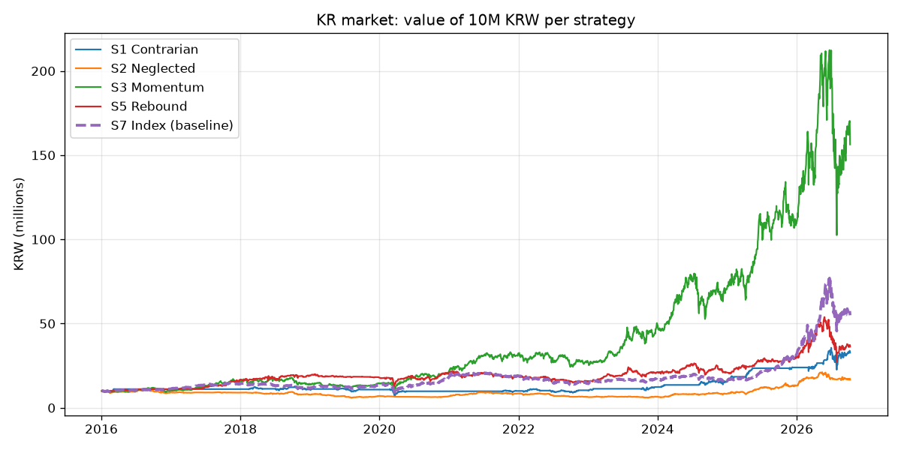
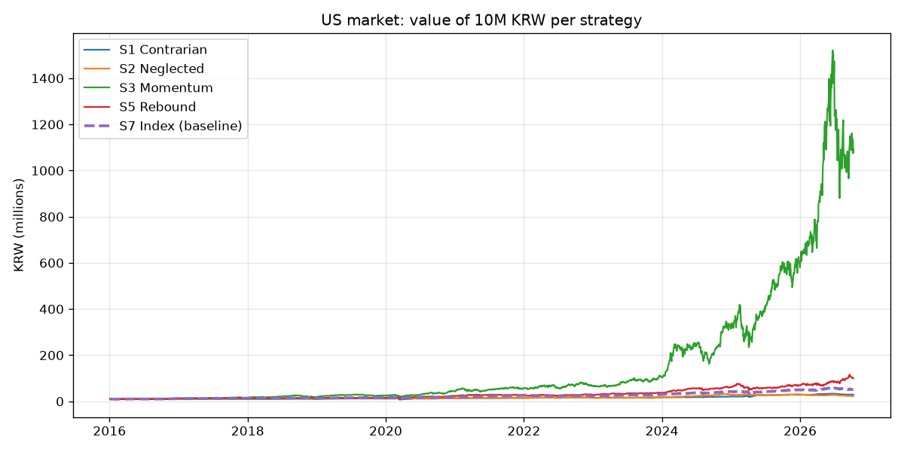

# stock-lab 과거 테스트 결과

- 기간: 2016-01-01 ~ 최근, 전략별 가상 10,000,000원 (미국은 시작 시점 환율로 달러 환전)
- 신호는 종가로 판단 → 다음 날 시가에 체결, 정수 주식만, 수수료·매도세 반영
- 미국 결과는 원화 환산이라 환율 변동이 포함돼 있어요

> ⚠️ 꼭 감안할 점: 종목 명단을 '지금' 기준으로 썼기 때문에, 지난 10년간 망하거나 지수에서 빠진 회사가 빠져 있어요. 그래서 결과가 실제보다 좋아 보이는 경향이 있습니다. 전략 간 '성격 비교'용으로 보세요. 미국 주식 양도소득세는 반영하지 않았고, ②는 재무 데이터 없이 가격·거래량만 쓴 간이판입니다. ④마법공식과 ⑥Claude 판단은 실시간 모의에서 평가해요.

### 국내 시장 성적표

| 전략 | 최종 금액 | 총수익률 | 연평균 | 최대 낙폭 | 완료 거래 | 승률 |
|---|---|---|---|---|---|---|
| ①역발상 | 32,720,303원 | +227.2% | +11.6% | -42.9% | 220 | 65% |
| ②소외우량주 | 16,679,280원 | +66.8% | +4.9% | -43.9% | 660 | 39% |
| ③모멘텀 | 156,342,688원 | +1463.4% | +29.1% | -51.7% | 165 | 52% |
| ⑤단기반등 | 36,312,112원 | +263.1% | +12.7% | -49.7% | 1628 | 59% |
| ⑦기준선(지수) | 54,955,261원 | +449.6% | +17.2% | -40.8% | 0 | - |

**상황별 성적 (연환산 수익률, 괄호는 그 상황이었던 기간 비중)**

| 전략 | 상승장·잔잔 (32%) | 상승장·요동 (28%) | 하락장·잔잔 (13%) | 하락장·요동 (28%) |
|---|---|---|---|---|
| ①역발상 | +2.3% | +9.9% | +2.8% | +36.1% |
| ②소외우량주 | -1.1% | +20.1% | -2.4% | +5.1% |
| ③모멘텀 | +36.8% | +31.3% | -3.2% | +45.8% |
| ⑤단기반등 | +17.3% | +10.6% | +6.1% | +24.5% |
| ⑦기준선(지수) | +18.5% | +23.3% | -2.0% | +26.5% |

**매수 시점 상황별 거래 결과**

| 전략 | 매수 시 상황 | 거래 수 | 승률 | 평균 수익률 |
|---|---|---|---|---|
| ①역발상 | 상승장·요동 | 50 | 70% | +6.8% |
| ①역발상 | 하락장·요동 | 130 | 60% | +4.8% |
| ①역발상 | 하락장·잔잔 | 40 | 72% | +9.4% |
| ②소외우량주 | 상승장·요동 | 117 | 40% | +3.0% |
| ②소외우량주 | 상승장·잔잔 | 200 | 49% | +2.3% |
| ②소외우량주 | 하락장·요동 | 233 | 36% | +1.0% |
| ②소외우량주 | 하락장·잔잔 | 110 | 29% | -2.9% |
| ③모멘텀 | 상승장·요동 | 35 | 54% | +16.4% |
| ③모멘텀 | 상승장·잔잔 | 56 | 55% | +39.4% |
| ③모멘텀 | 하락장·요동 | 55 | 49% | +25.9% |
| ③모멘텀 | 하락장·잔잔 | 19 | 42% | +38.1% |
| ⑤단기반등 | 상승장·요동 | 577 | 58% | +0.3% |
| ⑤단기반등 | 상승장·잔잔 | 514 | 58% | +0.6% |
| ⑤단기반등 | 하락장·요동 | 385 | 60% | +0.6% |
| ⑤단기반등 | 하락장·잔잔 | 152 | 62% | +0.8% |

### 미국 시장 성적표

| 전략 | 최종 금액 | 총수익률 | 연평균 | 최대 낙폭 | 완료 거래 | 승률 |
|---|---|---|---|---|---|---|
| ①역발상 | 28,819,884원 | +188.2% | +10.3% | -42.3% | 139 | 74% |
| ②소외우량주 | 22,269,704원 | +122.7% | +7.7% | -31.1% | 546 | 51% |
| ③모멘텀 | 1,093,685,413원 | +10836.9% | +54.7% | -44.0% | 208 | 55% |
| ⑤단기반등 | 100,319,494원 | +903.2% | +23.9% | -39.2% | 1916 | 60% |
| ⑦기준선(지수) | 52,337,790원 | +423.4% | +16.6% | -30.1% | 0 | - |

**상황별 성적 (연환산 수익률, 괄호는 그 상황이었던 기간 비중)**

| 전략 | 상승장·잔잔 (52%) | 상승장·요동 (30%) | 하락장·잔잔 (2%) | 하락장·요동 (16%) |
|---|---|---|---|---|
| ①역발상 | +7.5% | -10.0% | -32.3% | +78.9% |
| ②소외우량주 | +9.2% | +12.8% | -32.7% | +4.6% |
| ③모멘텀 | +42.8% | +55.0% | +46.8% | +82.5% |
| ⑤단기반등 | +20.9% | +19.7% | +30.1% | +49.9% |
| ⑦기준선(지수) | +18.3% | +7.2% | -3.2% | +36.7% |

**매수 시점 상황별 거래 결과**

| 전략 | 매수 시 상황 | 거래 수 | 승률 | 평균 수익률 |
|---|---|---|---|---|
| ①역발상 | 상승장·요동 | 39 | 90% | +9.1% |
| ①역발상 | 하락장·요동 | 90 | 67% | +7.0% |
| ①역발상 | 하락장·잔잔 | 10 | 80% | +6.8% |
| ②소외우량주 | 상승장·요동 | 177 | 51% | +1.3% |
| ②소외우량주 | 상승장·잔잔 | 315 | 52% | +2.3% |
| ②소외우량주 | 하락장·요동 | 50 | 44% | -0.2% |
| ②소외우량주 | 하락장·잔잔 | 4 | 75% | +1.0% |
| ③모멘텀 | 상승장·요동 | 59 | 51% | +40.6% |
| ③모멘텀 | 상승장·잔잔 | 107 | 55% | +30.8% |
| ③모멘텀 | 하락장·요동 | 40 | 60% | +32.0% |
| ③모멘텀 | 하락장·잔잔 | 2 | 50% | +17.9% |
| ⑤단기반등 | 상승장·요동 | 601 | 60% | +0.9% |
| ⑤단기반등 | 상승장·잔잔 | 991 | 58% | +0.5% |
| ⑤단기반등 | 하락장·요동 | 290 | 67% | +0.8% |
| ⑤단기반등 | 하락장·잔잔 | 34 | 68% | +0.7% |

## 파일 안내

- `trades.csv`: 모든 거래 기록 (엑셀로 열면 돼요)
- `kr_equity.csv`, `us_equity.csv`: 전략별 매일 평가금액
